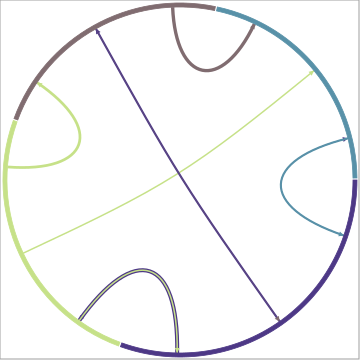

# chordp — chord diagram

Nodes are arranged as arcs around a circle and edges drawn as chords (curved
or bundled) between them. By default the node order is derived by
hierarchically clustering the edge weights — which `count=` feeds — so the
ring arranges related nodes near each other; pin an explicit order with
`order=`.

Requires the `[layouts]` extra: `pip install polars2svg[layouts]`.



```python
flows = [("North", "South", 8.0), ("North", "East", 5.0), ("North", "West", 3.0),
         ("South", "East", 6.0), ("South", "West", 4.0), ("East", "West", 7.0),
         ("West", "North", 5.0), ("East", "North", 2.0), ("South", "North", 4.0)]
df = pl.DataFrame({"fm":     [a for a, _, _ in flows],
                   "to":     [b for _, b, _ in flows],
                   "weight": [w for _, _, w in flows]})

p2s.chordp(df, [("fm", "to")], count="weight", node_size="vary",
           link_size="vary", color="fm", node_color=p2s.COLOR_BY_NODE_NAME,
           wxh=(360, 360))
```

## Key parameters

| Parameter | Forms | Notes |
|-----------|-------|-------|
| `relationships` | `[('from', 'to')]`, tuple fields | Tuple fields concatenate with `\|`. |
| `count` | `p2s.ROW_COUNTp` (default), `'field'`, `('field', p2s.SETp)` | Sets edge weights: feeds the derived node order always; scales arc/ribbon **geometry** only with `node_size='vary'` / `link_size='vary'`. With order pinned and fixed sizes it is inert (one-time warning). An edge whose count sums below zero is treated as zero, with a warning. |
| `color` | `'src'`, `'dst'`, `'field'`, `('field', enum)`, `'#rrggbb'` | `'src'` / `'dst'` inherit the endpoint node's color. |
| `node_color` | `p2s.COLOR_BY_NODE_NAME`, `'#rrggbb'`, `'field'` | |
| `node_size`, `link_size` | fixed (default) or `'vary'` | `node_size='vary'` sizes each node's arc by its count. `link_size='vary'` makes chord width proportional to count from zero, the largest chord at the top of `link_size_range` (default `(0.25, 4)`) and its first value a floor. |
| `link_shape` | `'curve'` (default), `'bundled'` | |
| `order` | list | Pin the ring order explicitly. |
| `legend` | `True`, position string, dict | |

Interactive variant: `p2s.chordpi(...)`.

## Citation

The chord diagram was introduced by Martin Krzywinski and colleagues in the
Circos tool. If you use `chordp` in published work, please cite:

> M. Krzywinski, J. Schein, I. Birol, J. Connors, R. Gascoyne, D. Horsman,
> S. J. Jones, and M. A. Marra, "Circos: an information aesthetic for
> comparative genomics," *Genome Research*, vol. 19, no. 9, pp. 1639–1645,
> 2009. [doi:10.1101/gr.092759.109](https://doi.org/10.1101/gr.092759.109)

The `link_shape='bundled'` option uses hierarchical edge bundling:

> D. Holten, "Hierarchical Edge Bundles: Visualization of Adjacency Relations
> in Hierarchical Data," *IEEE Transactions on Visualization and Computer
> Graphics*, vol. 12, no. 5, pp. 741–748, 2006.
> [doi:10.1109/TVCG.2006.147](https://doi.org/10.1109/TVCG.2006.147)
